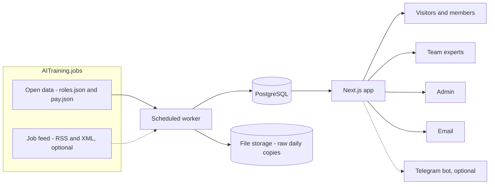
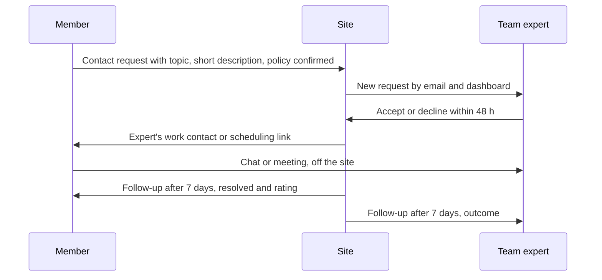
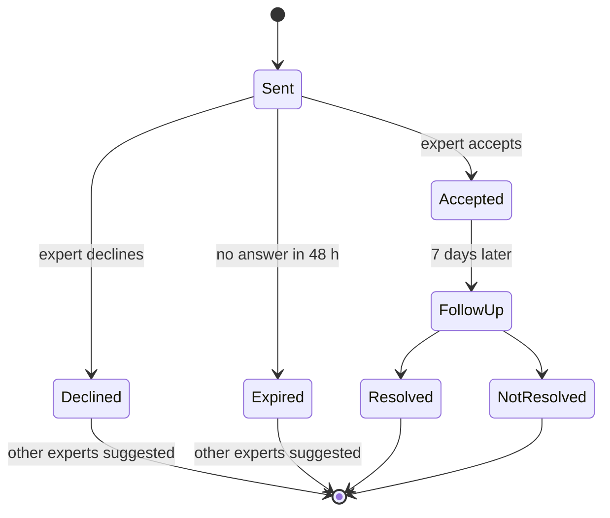

# AI Training Opportunity & Expert Support Platform

**System design · Version 3.2 · 13 November 2026**

| | |
|---|---|
| **Status** | Proposed for build |
| **Replaces** | v2.1 (paid plans with crypto billing) |
| **Model** | Free for everyone |
| **Audience** | Product owner, engineering team, AI coding agents, QA, operations |
| **Conventions** | **MUST**, **SHOULD** and **MAY** follow RFC 2119. Requirement IDs (for example `EXP-04`) are stable: cite them in code, tests and pull requests. |

---

## 1. Summary

The service has two jobs:

1. **Attract experts into AI training work.** It shows real market data as charts and figures: how many roles are open, which kinds of work are growing, and what they pay. Doctors, lawyers, engineers, linguists and other professionals can see where their skills are in demand.
2. **Help them succeed.** When experts run into problems, the site connects them with members of our own team who have already worked through the same problems. The conversation then continues directly between the two people, by chat or meeting.

Everything is free. Data comes from AITraining.jobs open data (CC BY 4.0) and, for the optional jobs module, from their partner feed under terms confirmed on 9 November 2026.

### What changed in v3.2 (13 November 2026)

- The **Platforms** page is now a four-part guide: platform status (the platform race), projects by sector, pay, and contact.
- Added a **general contact section** that anyone can use without signing in: an email form, plus Telegram and Discord links (`CON-01` to `CON-06`, §6). See [ADR 0005](adr/0005-public-contact-form.md).
- The site is light only (black text on a white page) with a larger, roomier layout.

### What changed in v3.1 (12 November 2026)

Added the **platform race** page (`TRD-11`): each day, per-platform counts of new roles and big-pay roles from the AITraining.jobs job search, alongside open roles from `roles.json`. See [ADR 0004](adr/0004-platform-counts-from-job-search.md).

### What changed from v2.1

| Area | v2.1 | v3.0 |
|---|---|---|
| Pricing | Three paid plans ($1, $2, $3 per month) | Free for everyone |
| Payments | Direct USDC payments, deposit addresses, ledger, refunds | None |
| Expert help | Ticket system, credits, screening engine, engineer payouts | Team expert directory and contact requests; conversations continue by chat or meeting |
| Market data | Not included | New **Trends** module |
| Jobs | Core feature | Optional free module (phase 3) |
| Kept | AITraining.jobs source rules, 3-state eligibility, security baseline | Same |

---

## 2. Goals, users and boundaries

### Success measures

- Trend pages are updated every day. No chart is ever more than 26 hours old without a visible "out of date" notice.
- At least 90% of contact requests get an answer (accept or decline) from a team expert within 48 hours.
- Tracked weekly: visitors to trend pages, sign-ups, contact requests, share of requests marked "resolved", reports upheld.
- Zero upheld policy incidents involving task content or assessments.

### Roles

| Role | Can | Limits |
|---|---|---|
| Visitor | Read trend pages, browse expert profiles (without contact details), browse jobs | No contact requests, alerts or tracker |
| Member (signed in) | Send contact requests, see an expert's work contact after the expert accepts, use alerts and tracker | Own data only; request limits (`EXP-09`) |
| Team expert | Edit own profile, set availability and weekly capacity, accept or decline requests, record outcomes | Sees only requests sent to them |
| Admin | Manage experts, review reports, watch data health, edit trend page text | MFA required; every action audited |

### Boundaries

**In scope:** public market data with credit, introductions between members and our team experts, sharing experience and skills, public job listings with permitted links.

**Never:**

- Help with the content of a specific task, assessment answers, or project guidelines and rubrics covered by a confidentiality agreement.
- Review a member's work before they submit it to a platform.
- Ask for or use anyone's platform login, or log in to platforms on their behalf.
- Scrape logged-in pages, submit applications automatically, or bypass CAPTCHAs.
- Promise acceptance, work or earnings.
- Let experts take private payments from members. The service is free, so experts do not charge members.

The principle for team experts: **share experience, not answers.**

---

## 3. Business model

The service is free for users. Its costs are team time and hosting. Funding is an open decision (§13). Options, which can be combined:

- **Recruiting partnerships.** Platforms pay to reach qualified experts. The trend pages attract exactly that audience.
- **Referral income** from platforms we make direct agreements with.
- **Sponsorship** of trend pages or reports, clearly labelled.
- **Optional paid extras** later, such as in-depth reports. These must never be needed to use the core service.

Measure from day one what partners will ask about: experts attracted per profession and kind of work, sign-ups, and contact outcomes.

---

## 4. Architecture

| Component | Choice | Notes |
|---|---|---|
| App | One Next.js + TypeScript codebase (pages and API routes) | Trend pages rendered on the server so search engines index them. FastAPI remains an option if the team prefers Python |
| Charts | Recharts | Line, bar, range and sparkline charts; every chart has an accessible data table |
| Share images | Server-generated Open Graph images per chart | So shared links show the chart on social media |
| Database | PostgreSQL 16 | Point-in-time recovery |
| Worker | Scheduled job runner (cron or a small queue) | Daily trend collection; feed polling if the jobs module is on |
| File storage | S3-compatible | Raw copies of every downloaded data file; expert photos |
| Email | Transactional provider with SPF, DKIM, DMARC | Contact requests, follow-ups, alerts |
| Sign-in | Email magic link or passkey; MFA for team experts and admins | |
| Meetings | External scheduling links set by each expert | No meeting system built in |
| Observability | Error tracking, uptime checks, job-run dashboard | |
| Delivery | GitHub Actions; staging and production | Migrations gated in CI |

---

## 5. Trends module

### Data sources

AITraining.jobs open data, licensed **CC BY 4.0**: reuse is allowed when AITraining.jobs is credited and the data date is given.

| File | Contents |
|---|---|
| `https://aitraining.jobs/roles.json` | Totals (open roles, live platforms, new roles in the last 7 days); open roles and pay by kind of work; open roles by platform; new roles per week |
| `https://aitraining.jobs/pay.json` (also `pay.csv`) | Advertised hourly pay by kind of work |
| `https://aitraining.jobs/api/v1/jobs` (job search) | Open roles matching filters. Once a day we read only the `total` of three searches per platform (`TRD-11`); the roles in the answers are never stored |
| Field reference | `https://aitraining.jobs/data` |

Example from 9 November 2026, to show the shape of the data:

| Measure | Value |
|---|---|
| Open roles / live platforms / new in last 7 days | 4,376 / 62 / 388 |
| Law, Medicine & Finance | 1,611 open roles, 40 platforms, median **$75/h** (typical $40–$150), 1,082 rate samples |
| Multilingual & Localization | 825 open roles, 19 platforms, median **$35/h** (typical $25–$65) |
| Largest platforms by open roles | Invisible 533, SuperAnnotate 379, micro1 378, Alignerr 316, Mercor 269 |

These files hold only the current day's figures. **Saving a copy every day builds our own history**, which is what makes trend charts possible.

### Requirements

| ID | Requirement |
|---|---|
| `TRD-01` | Once a day at a fixed UTC time, download `roles.json` and `pay.json`. Store the raw file and the parsed rows under the data's own date (`temporal_coverage`). Running twice on the same date MUST NOT create a second snapshot. |
| `TRD-02` | Validate every file against the expected schema. If fields change, or total open roles moves more than 50% from the previous day, do not publish; alert an admin. |
| `TRD-03` | Never fill in missing days. A missing day appears as a gap in charts. |
| `TRD-04` | Every chart, page, shared image and export MUST show: "Data: AITraining.jobs open data (CC BY 4.0), [date]", with a link. |
| `TRD-05` | Publish charts and summary figures only. Do not publish a role-by-role history; AITraining.jobs sells that as a separate product. |
| `TRD-06` | Every chart states what is counted, the data date and the sample size (rate samples, number of platforms). |
| `TRD-07` | Pay is labelled "advertised hourly pay", never "earnings". Show median and typical range together. |
| `TRD-08` | Hide a pay figure when it rests on fewer than 10 rate samples. |
| `TRD-09` | Trend pages show a notice when the latest snapshot is more than 26 hours old. |
| `TRD-10` | Each chart has a stable URL, a data table for screen readers, and a server-generated share image. |
| `TRD-11` | Once a day, after `roles.json`, count three figures for every platform listed in it, using the job search: open roles, roles first listed in the last 7 days, and roles whose advertised hourly pay reaches $100 at the top of its range. Keep only the counts, the settings used and a raw record of them. Store nothing when a search fails. Hold (do not publish) when the platform counts add up to more than 50% away from `roles.json`, or when a filter looks ignored (new or big-pay roles equal all open roles). Skip when the newest `roles.json` is more than 1 day old, because the search is live. |

### Pages

| Page | Shows |
|---|---|
| **Overview** | Open roles, live platforms, new roles in the last 7 days; new roles per week; top kinds of work by open roles |
| **Kind of work** (one page each, for example "Law, Medicine & Finance") | Open roles over time, median and typical pay, number of platforms, a short team-written explanation of the work, links to matching team experts and jobs |
| **Pay** | Median and typical range for every kind of work, side by side |
| **Platforms** (a four-part guide) | Today's headline figures, then: **1. Platform status:** an animated leaderboard with three races (most open roles, most new roles in the last 7 days, most roles advertising $100+ an hour), the top 10 with ties at 10th, places gained or lost when you switch races, commentary written from the figures, and a link per race (`#race-new`). **2. Projects by sector:** open roles and share for each kind of work. **3. Pay:** advertised hourly pay by sector, and each platform's share of roles advertising $100+ an hour (platforms with at least 20 open roles). **4. Contact** (`CON-01` to `CON-06`). Change over time comes once history builds up |

The **kind-of-work pages** are the main way experts arrive: a nurse searching "AI training jobs for nurses" should land on the right page, see real figures, and find a team expert from the same field.

---

## 6. Expert directory and contact

### Expert profiles

Profiles exist only for members of our own team.

| Field | Notes |
|---|---|
| Display name, optional photo | Each expert consents in writing to what is shown |
| Headline and professions | Linked to the kinds of work used on trend pages |
| Problems they can help with | Tags from the controlled list below |
| Skills, languages, time zone | |
| Availability and weekly capacity | Number of new requests per week they accept |
| Contact channels offered | Work email on our domain, a work Telegram account, or a scheduling link. **Never personal contacts.** |
| Outcome summary | Requests handled, share marked resolved |

Profiles MUST NOT name confidential projects, clients or customers. Some platforms forbid saying which project a person worked on.

### Problem tags (controlled list)

- **Getting accepted:** applications, profiles, résumés, onboarding steps that platforms publish
- **Assessment preparation:** general skills and practice material only, never real assessment questions
- **Skills:** coding, math, writing, domain knowledge, how AI evaluation works in general
- **Tools and setup:** environments, time tracking, common software
- **Work habits:** workload, quality, consistency, handling rejections
- **Payments and taxes:** general information only
- **Scams and safety:** spotting fake offers and protecting accounts
- **Career:** moving into better-paid kinds of work

### Contact flow

### Requirements

| ID | Requirement |
|---|---|
| `EXP-01` | Only signed-in members can send contact requests. Visitors see profiles without contact channels. |
| `EXP-02` | The request form asks for problem tags, a short description (up to 500 characters), preferred channel, and time zone. The member MUST tick: "I will not share task content, assessment questions or confidential project material, and I follow my platform's rules." |
| `EXP-03` | The site suggests experts ranked by matching problem tags and profession, then by past resolved outcomes on those tags, then by remaining weekly capacity. |
| `EXP-04` | An expert's contact channels are shown only to the member whose request that expert accepted, and only after acceptance. They never appear in public page HTML. |
| `EXP-05` | A request not answered within 48 hours expires, and the member is offered other experts. A declined request does the same. |
| `EXP-06` | Experts set a weekly capacity. When every matching expert is full, the member can join a waitlist and is notified when someone is free. |
| `EXP-07` | Seven days after acceptance, both sides get a follow-up: resolved or not, and a 1–5 rating from the member. |
| `EXP-08` | With the member's permission, a resolved case can become an anonymized guide in a public "Solved problems" library. This library also improves matching (`EXP-03`). An admin reviews every guide before publishing. |
| `EXP-09` | Limits per member: 3 open requests at a time and 5 new requests per week. Limits live in configuration. |
| `EXP-10` | Every profile and every follow-up email has a **Report** link. Reports reach an admin, who reviews them within 48 hours and can pause an expert's profile. |
| `EXP-11` | The site stores only the request, its status and the outcome. Conversations happen off the site and are not recorded by us. |
| `EXP-12` | Experts MUST NOT ask members for platform logins or account access, and MUST NOT take payments from members. |

### Safeguards

The team agreement (Appendix B) is our main protection: the experts are our team, so platforms will treat their actions as ours. The community rules (Appendix A) are shown on the request form and linked from every profile.

### General contact (before sign-in)

Until expert matching launches, the Platforms page has a contact section for anyone who is struggling with AI training. It reaches our team in general, not a chosen expert, so it needs no sign-in. See [ADR 0005](adr/0005-public-contact-form.md).

| ID | Requirement |
|---|---|
| `CON-01` | The Platforms page has a contact section that anyone can use without signing in: an email form, plus Telegram and Discord links. It offers general help (choosing platforms, getting accepted, finding work, pay, using your field). It does not replace expert contact requests, which still need sign-in (`EXP-01`). |
| `CON-02` | The form asks for an email address, a topic from a fixed list, a message (20 to 1,000 characters) and, optionally, a name. The sender MUST tick the same confirmation as `EXP-02`. The server checks every field again. |
| `CON-03` | Messages are stored on the server only and never shown on any public page. Until an email provider is chosen (§13), the team reads them with `npm run contact:list`. |
| `CON-04` | At most 3 messages per network address per hour, and a hidden field turns bots away (`SEC-04`). The address is stored only as a salted hash. |
| `CON-05` | The Telegram and Discord buttons appear only once their links are set in configuration. They are team or community channels, never anyone's personal account (`SEC-03`). |
| `CON-06` | The section says plainly that we never ask for platform logins or passwords and never do assessments or tasks for anyone, and asks people not to send task content (`EXP-12`, Appendix A). |

---

## 7. Jobs module (optional, free)

This module carries over from v2.1 unchanged in substance. It is phase 3 and can be left out of the first release.

**AITraining.jobs terms (confirmed 9 November 2026):** paying users may see the roles (this also covers a free service); every listing links through AITraining.jobs, and their `/go/` redirect may be used; polling frequency is our choice. Still pending: a `/go/` field in the feed and how clicks are credited to us.

| ID | Requirement |
|---|---|
| `JOB-01` | Read the RSS feed (newest 100 roles) every 30 minutes and the full XML feed (all pages, 5 seconds apart) every 3 hours, with a User-Agent naming the service and a contact address. |
| `JOB-02` | A full read is complete only when every page returned and parsed, and the count matches `totaljobs` within 0.5%. A role closes only after it is missing from 2 complete reads in a row. RSS never closes roles. |
| `JOB-03` | Store `listing_url` and, once provided, `apply_url` (the `/go/` link). Apply uses `apply_url`, else `listing_url`. Never link to a platform URL taken from a description. |
| `JOB-04` | Show pay exactly as the feed states it. Sanitize description HTML. |
| `JOB-05` | Eligibility is eligible, not eligible or unknown, with reasons. Country checks use the feed's country lists. |
| `JOB-06` | Alerts by email and optional Telegram, with timezone, quiet hours, unsubscribe and a unique key per notification so nothing is sent twice. |
| `JOB-07` | Application tracker with user-entered stages, reminders and notes, plus a warning not to paste confidential assessment content. |

---

## 8. Data model

| Entity | Key fields |
|---|---|
| `users` | id, email, role (member, expert, admin), status, locale, timezone, created_at |
| `member_profiles` | user_id, professions[], kinds_of_work[], languages[], country |
| `consents` | user_id, kind, version, granted_at, revoked_at |
| `experts` | user_id, display_name, headline, photo_file_id, professions[], kinds_of_work[], languages[], timezone, weekly_capacity, status (active, paused), profile_consent_at |
| `expert_tags` | expert_id, tag |
| `expert_channels` | expert_id, kind (work_email, telegram, scheduling_link), value |
| `contact_requests` | id, member_id, expert_id, tags[], description, preferred_channel, member_timezone, policy_confirmed_at, status (sent, accepted, declined, expired), created_at, answered_at |
| `request_outcomes` | request_id, resolved, rating, expert_note, recorded_at |
| `waitlist` | member_id, tags[], created_at, notified_at |
| `guides` | id, source_request_id, title, body, tags[], status (draft, published), published_at, reviewed_by |
| `reports` | id, reporter_id, target_type, target_id, reason, status, decided_by, decided_at |
| `trend_snapshots` | id, data_date, file_kind, raw_file_id, sha256, fetched_at, published |
| `trend_totals` | data_date, open_roles, platforms_live, new_last_7d |
| `trend_work_types` | data_date, slug, label, open_count, median, typical_low, typical_high, rate_samples, platforms |
| `trend_platforms` | data_date, slug, name, open_count |
| `trend_weekly` | iso_week, new_roles, as_of_date |
| `contact_messages` | id, created_at, name, email, topic, message, policy_confirmed_at, address_hash, status (new, answered) |
| `sources`, `source_syncs`, `jobs`, `job_versions`, `saved_jobs`, `applications`, `notifications` | Jobs module only; as in v2.1 §13 |
| `audit_events` | actor_id, action, resource, at (append-only) |

---

## 9. API

All endpoints return JSON with `application/problem+json` errors and are rate-limited.

| Group | Endpoints | Who |
|---|---|---|
| Trends | `GET /api/trends/overview` · `GET /api/trends/work-types` · `GET /api/trends/work-types/{slug}` · `GET /api/trends/pay` · `GET /api/trends/platforms` | Public |
| Auth | `POST /api/auth/magic-link` · `POST /api/auth/verify` · `POST /api/auth/logout` | Everyone |
| Me | `GET/PATCH /api/me` · `GET /api/me/export` · `POST /api/me/delete` | Member |
| Experts | `GET /api/experts` (filter by tag, profession, language) · `GET /api/experts/{id}` | Public; no contact channels |
| Requests | `POST /api/requests` · `GET /api/requests` · `GET /api/requests/{id}` (channels shown when accepted) · `POST /api/requests/{id}/outcome` | Member |
| Waitlist | `POST /api/waitlist` · `DELETE /api/waitlist` | Member |
| Guides | `GET /api/guides` · `GET /api/guides/{id}` | Public |
| Reports | `POST /api/reports` | Member |
| Expert console | `GET /api/expert/requests` · `POST /api/expert/requests/{id}/accept` · `POST /api/expert/requests/{id}/decline` · `POST /api/expert/requests/{id}/outcome` · `PATCH /api/expert/profile` | Expert, MFA |
| Admin | `GET /api/admin/data-health` · `POST /api/admin/trends/{date}/publish` · `GET/POST /api/admin/reports` · `POST /api/admin/experts/{id}/pause` · `POST /api/admin/guides/{id}/publish` · `GET /api/admin/audit` | Admin, MFA |
| Jobs (optional) | As in v2.1 §14 | Public and member |

---

## 10. Security and privacy

| ID | Requirement |
|---|---|
| `SEC-01` | MFA for team experts and admins. Members sign in with a magic link or passkey. |
| `SEC-02` | Object-level authorization on every resource. A member sees only their own requests; an expert sees only requests sent to them. |
| `SEC-03` | Contact channels are stored server-side and released only under `EXP-04`. Experts use work channels on our domain or work accounts, never personal ones. |
| `SEC-04` | Rate limits per IP and per account. Bot protection on sign-up and on contact requests. |
| `SEC-05` | Data minimization; consent records for members and experts; data export and deletion within 30 days; a privacy policy and terms of use. |
| `SEC-06` | A strict Content Security Policy, CSRF protection, sanitized user and source text, and file-type and size limits on photos. |
| `SEC-07` | An append-only audit log for admin actions and access to contact channels. |
| `SEC-08` | Dependency and secret scanning in CI; checks against OWASP ASVS Level 2 before launch. |

---

## 11. Operations

| Task | Schedule |
|---|---|
| Trend data download and validation | Daily, fixed UTC time |
| Trend page rebuild and share images | After each successful download |
| Request expiry and "suggest other experts" | Hourly |
| 7-day follow-ups | Daily |
| Waitlist notifications | Hourly |
| Jobs RSS / full feed (if enabled) | Every 30 min / every 3 h |
| Backups | Continuous plus nightly; restore drill monthly |

**Alerts to the team:**
- a failed or rejected trend download
- a trend page older than 26 hours
- requests nearing 48 hours unanswered
- a new report
- the error rate

---

## 12. Delivery phases

Sizes are rough, for one or two developers.

| Phase | Deliverables | Exit criteria | Rough size |
|---|---|---|---|
| **0 · Discovery** | Product name and domain; trend pages mentioned to AITraining.jobs; team agreement signed; expert profile consents; wireframes; decision records | Every decision in §13 resolved or given an owner and date | 1 week |
| **1 · Trends (public launch)** | Daily collection, validation, overview, kind-of-work, pay and platform pages, credit lines, share images | AT-01 to AT-05 pass; pages indexed | 2–3 weeks |
| **2 · Experts** | Sign-in, expert profiles, matching, contact requests, follow-ups, waitlist, guides, reports, expert and admin consoles | AT-06 to AT-11 and AT-14 pass; 5 team experts live | 3–4 weeks |
| **3 · Jobs (optional)** | Feed adapter, explorer, eligibility, alerts, tracker | AT-12, AT-13 pass | 3 weeks |
| **4 · Growth and funding** | Partner reporting, referral agreements, sponsorship slots | First funding agreement signed | Ongoing |

---

## 13. Open decisions

| Decision | Status | Owner | Notes |
|---|---|---|---|
| AITraining.jobs: showing roles; linking through them; polling | Resolved | Product owner | Confirmed 9 Nov 2026 |
| AITraining.jobs: `/go/` field in feed and click credit | Pending | Product owner | Only needed for the jobs module |
| Tell AITraining.jobs about the trend pages | Pending | Product owner | The licence already allows it; telling them keeps the partnership healthy |
| Product name and domain | Pending | Business owner | Needed for credit links, email and the feed `source=` tag |
| Funding model | Pending | Business owner | See §3 |
| Contact channels and scheduling tool | Pending | Operations | Work email, work Telegram, scheduling links; the Telegram and Discord links for the contact section (`CON-05`) |
| Email delivery for contact messages | Pending | Operations | Needs the product domain and an email provider; until then the team reads messages with `npm run contact:list` (`CON-03`) |
| How expert names appear (full name or first name) | Pending | Operations | Needs each expert's written consent |
| Jobs module in the first release | Pending | Product owner | Recommended: after experts (phase 3) |
| Privacy policy, terms of use, disclaimers | Pending | Legal | Include "no guarantee of work" and "experts give general guidance" |

---

## 14. Acceptance tests

| ID | Test |
|---|---|
| AT-01 | Running the daily trend download twice on the same date creates one snapshot. |
| AT-02 | A schema change or a jump of more than 50% in total open roles blocks publishing and alerts an admin. |
| AT-03 | Every chart, page and share image shows the AITraining.jobs credit line with the data date. |
| AT-04 | A missing day appears as a gap; nothing is filled in. |
| AT-05 | Pay figures with fewer than 10 rate samples are hidden; shown pay is labelled "advertised". |
| AT-06 | Expert contact channels are visible only to the member whose request was accepted, and never in public HTML. |
| AT-07 | A contact request cannot be sent without the policy confirmation. |
| AT-08 | A request unanswered for 48 hours expires and the member is offered other experts. |
| AT-09 | A member over the request limits is stopped with a clear message. |
| AT-10 | A report reaches an admin, and an admin can pause the expert's profile. |
| AT-11 | A member cannot see another member's requests; an expert cannot see requests sent to other experts. |
| AT-12 | (Jobs) Apply uses `apply_url` when present, else `listing_url`; never a description link. |
| AT-13 | (Jobs) An incomplete feed read never closes a role. |
| AT-14 | Deleting an account removes the member's personal data from requests within 30 days. |
| AT-15 | A contact-form message without the rules confirmation, with a wrong email address or with a too-short message is refused with a clear message, and what was typed is kept. |
| AT-16 | A fourth contact-form message from the same address within an hour is refused; a filled hidden field stores nothing. |

---

## 15. Instructions for AI development agents

- Treat this document as the baseline. Cite requirement IDs in commits, tests and pull requests.
- Before full implementation, produce decision records, the API contract, database migrations, wireframes and a test plan.
- Use recorded copies of `roles.json`, `pay.json` and the feed as test fixtures. Do not call live endpoints in tests.
- Read limits, schedules and thresholds from configuration, never from constants.
- Never scrape logged-in pages, store third-party credentials, or submit applications automatically.
- Build authorization, audit logging and the credit line from the first commit.
- Deliver in reviewable increments with tests, CI, deployment notes and a change log.

---

## Appendix A: Community rules (draft text for the site)

> **How our experts help**
>
> Our experts are members of our team who have done AI training work themselves. They share their experience: how to get accepted, which skills matter, how to work well and avoid scams.
>
> **What they will not do**
>
> They will not help with the content of a specific task, give assessment answers, discuss confidential project guidelines, or review your work before you submit it. They will never ask for your platform login or for money.
>
> **What we ask of you**
>
> Do not share task content, assessment questions or anything your platform treats as confidential. Follow the rules of every platform you work on. If anything feels wrong, use the Report link.

## Appendix B: Team expert agreement (key clauses)

1. **Confidentiality first.** I will not share or ask for task content, assessment questions or answers, or project guidelines covered by any platform's confidentiality agreement.
2. **No account access.** I will never ask for or use a member's platform login, and I will never act on a member's account.
3. **No payments.** I will not take money from members for help given through this service.
4. **Work channels only.** I will contact members only through the work channels the service provides.
5. **Accurate profile.** My profile lists my real skills and experience and names no confidential projects or clients.
6. **Reports.** I will tell an admin about any request that asks for prohibited help, and I accept that my profile can be paused while a report is reviewed.

---

*Market figures from AITraining.jobs open data (CC BY 4.0), read 9 November 2026. This document is not legal advice; have the privacy policy, terms and team agreement reviewed by a lawyer.*
